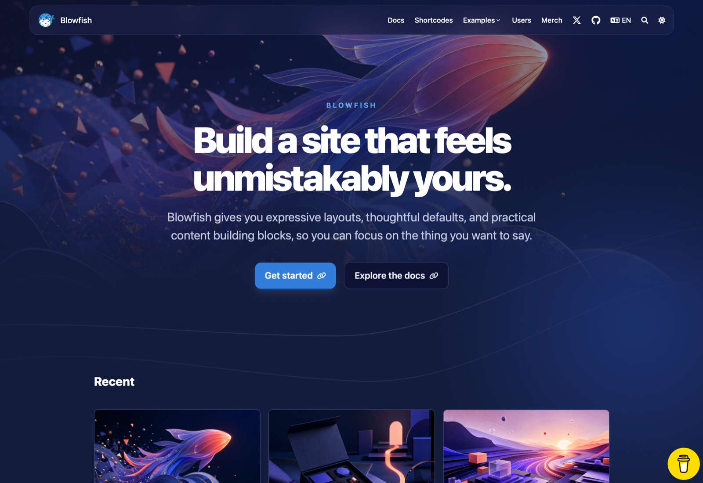
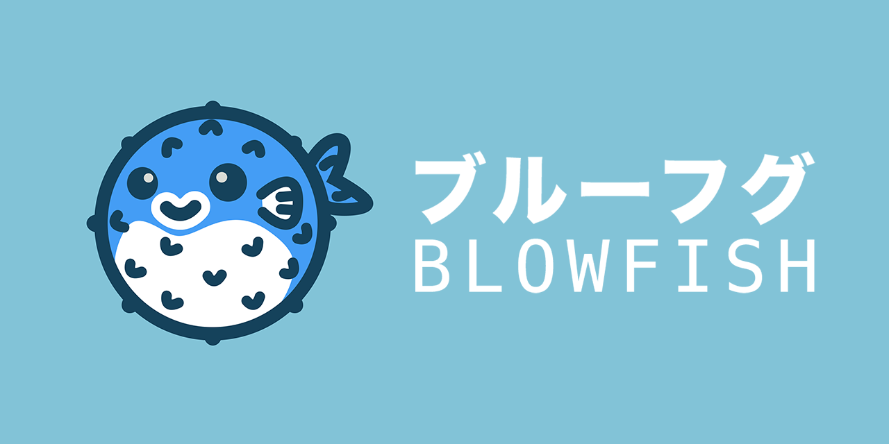

[English](README.md) | [Français](README.fr.md) | [Deutsch](README.de.md) | [Português (PT)](README.pt-pt.md) | [Português (BR)](README.pt-br.md) | [Español](README.es.md) | [日本語](README.ja.md) | [简体中文](README.zh-cn.md) | [Indonesian](README.id.md) | Tiếng Việt

# Blowfish

[](https://app.netlify.com/sites/snazzy-dango-efb2ec/deploys) [](https://github.com/gohugoio/hugo/releases/tag/v0.162.0) [](https://github.com/nunocoracao/blowfish/blob/main/LICENSE) [](https://themes.gohugo.io/themes/blowfish/) [](https://img.shields.io/github/languages/code-size/nunocoracao/blowfish)

Blowfish là một theme mạnh mẽ và nhẹ cho [Hugo](https://gohugo.io). Theme được xây dựng bằng Tailwind CSS với thiết kế gọn gàng, tối giản, ưu tiên nội dung của bạn.

[](https://github.com/nunocoracao/blowfish/blob/main/images/screenshot.png?raw=true)

🌏 [Trang demo](https://blowfish.page/)  
📑 [Tài liệu theme](https://blowfish.page/docs/)  
🐛 [Báo lỗi & issue](https://github.com/nunocoracao/blowfish/issues)  
💡 [Câu hỏi & đề xuất tính năng](https://github.com/nunocoracao/blowfish/discussions)

[](https://www.buymeacoffee.com/nunocoracao)

## Tính năng

- Bố cục hoàn toàn responsive, xây dựng bằng Tailwind CSS 4
- Nhiều bảng màu (hoặc tự tùy biến hoàn toàn)
- Chế độ tối (bật/tắt cố định hoặc tự động chuyển đổi kèm nút chuyển cho người dùng)
- Nhiều bố cục trang chủ, gồm cả trang đích kiểu sản phẩm với ảnh hero, số liệu thống kê và lưới tính năng
- Header kính nổi với phím tắt tìm kiếm ⌘K / Ctrl+K
- Canvas nền toàn cục, các hero mờ dần hòa vào nền khi cuộn trang
- Thanh tiến độ đọc cho bài viết
- Bộ chuyển bố cục trang chủ tương tác để xem trước trực tiếp
- Agent skill giúp các AI coding agent (như Claude Code) cài đặt và cấu hình theme cho bạn
- Trang thân thiện với việc in ấn, có style in riêng
- Cấu hình có thể tùy biến sâu
- Tích hợp Firebase để hỗ trợ dữ liệu động
- Đếm lượt xem & cơ chế thích bài viết
- Bài viết liên quan
- Nhiều tác giả
- Chuỗi bài viết (series)
- Sắp xếp bài viết theo ngày và theo trọng số
- Chế độ Zen khi đọc bài viết
- Linh hoạt với mọi loại nội dung, taxonomy và menu
- Menu header và footer
- Menu lồng nhau & menu điều hướng phụ
- Mục lục có thể cuộn
- Hỗ trợ nội dung đa ngôn ngữ, bao gồm các ngôn ngữ viết từ phải sang trái (RTL)
- Có thể liên kết đến bài viết trên các trang web bên thứ ba
- Hơn 40 shortcode, gồm Gallery, Timeline, thẻ GitHub, Carousel, Stats, lưới tính năng, Steps và nút CTA
- Cú pháp GitHub Alerts, 15 loại, hỗ trợ thu gọn
- Tích hợp Buymeacoffee
- Tìm kiếm phía client trên toàn site, chạy bằng Fuse.js
- Sơ đồ và trực quan hóa bằng Mermaid
- Biểu đồ bằng Chart.js
- Tích hợp TypeIt
- Nhúng YouTube với cải thiện hiệu năng
- Ký hiệu toán học bằng KaTeX
- Biểu tượng SVG từ FontAwesome 6
- Tự động đổi kích thước ảnh bằng Hugo Pipes
- Neo tiêu đề, mục lục, nút sao chép mã, nút bấm, huy hiệu và nhiều hơn nữa
- Hỗ trợ HTML và Emoji trong bài viết 🎉
- Thân thiện với SEO, có liên kết chia sẻ lên mạng xã hội
- Hỗ trợ Fathom Analytics và Google Analytics
- RSS feed, favicon và hỗ trợ bình luận
- Tùy biến nâng cao bằng các định nghĩa màu và style Tailwind đơn giản
- Tối ưu hiệu năng và khả năng truy cập, đạt điểm Lighthouse tuyệt đối
- Tài liệu đầy đủ, cập nhật thường xuyên

---

[](https://github.com/nunocoracao/blowfish/blob/main/logo.png?raw=true)

## Tài liệu

Blowfish có [tài liệu chi tiết](https://blowfish.page/docs/) bao quát mọi khía cạnh của theme. Hãy [đọc tài liệu](https://blowfish.page/docs/) để tìm hiểu thêm về cách sử dụng theme và các tính năng của nó.

---

## Cài đặt

Blowfish hỗ trợ nhiều cách cài đặt: dùng git submodule, dùng Hugo Module, hoặc cài thủ công hoàn toàn.

Hướng dẫn chi tiết cho từng cách có trong tài liệu [Cài đặt](https://blowfish.page/docs/installation). Bạn nên tham khảo tài liệu để có trải nghiệm thiết lập đơn giản nhất. Bên dưới là hướng dẫn bắt đầu nhanh dùng submodule nếu bạn đang dùng git, hoặc dùng Hugo module nếu bạn đã quen cài theme Hugo.

### Bắt đầu nhanh với AI agent

Blowfish có kèm một [agent skill](https://github.com/nunocoracao/blowfish/tree/main/.claude/skills/blowfish) hướng dẫn các AI coding agent — như Claude Code — cách cài đặt, cấu hình và xây dựng site bằng theme. Hãy cài skill này từ marketplace plugin của Blowfish trong Claude Code:

```
/plugin marketplace add nunocoracao/blowfish
/plugin install blowfish@blowfish
```

Hoặc đơn giản là sao chép thư mục skill vào repository site của bạn tại `.claude/skills/blowfish/` — các agent sẽ tự động nhận skill của dự án. Sau đó hãy nhờ agent thiết lập Blowfish cho bạn.

### Bắt đầu nhanh với Blowfish Tools

> **Lưu ý:** Hãy bảo đảm bạn đã cài **Node.js**, **Git** và **Hugo**, và đã tạo một dự án Hugo mới trước khi tiếp tục.

Blowfish Tools là một CLI giúp bạn bắt đầu với Blowfish. Nó sẽ tạo dự án Hugo mới, cài theme và thiết lập các tệp cấu hình theme cho bạn. Vui lòng [báo cáo mọi vấn đề bạn gặp](https://github.com/nunocoracao/blowfish-tools).

Cài đặt công cụ CLI ở phạm vi toàn cục bằng npm (hoặc trình quản lý gói khác):

```
npm i -g blowfish-tools
```

Sau đó chạy lệnh `blowfish-tools` để bắt đầu một phiên tương tác hướng dẫn bạn qua các trường hợp tạo mới và cấu hình.

```
blowfish-tools
```

Bạn cũng có thể chạy lệnh `blowfish-tools new` để tạo dự án Hugo mới và cài theme chỉ trong một bước. Xem trợ giúp của CLI để biết thêm thông tin.

```
blowfish-tools new mynewsite
```

### Bắt đầu nhanh với git submodule

> **Lưu ý:** Hãy bảo đảm bạn đã cài **Git** và **Hugo**, và đã tạo một dự án Hugo mới trước khi tiếp tục.

1. Từ thư mục dự án, khởi tạo git:

   ```
   git init
   ```

2. Cấu hình Blowfish làm git submodule:

   ```
   git submodule add -b main https://github.com/nunocoracao/blowfish.git themes/blowfish
   ```

3. Trong thư mục gốc của website, xóa tệp `hugo.toml` do Hugo tạo ra. Sao chép các tệp cấu hình `*.toml` từ theme vào thư mục `config/_default/` của bạn.

    Bạn sẽ thấy các tệp cấu hình theme này trong thư mục cache của Hugo, hoặc [tải một bản](https://github.com/nunocoracao/blowfish/releases/latest/download/config-default.zip) từ GitHub.

4. Làm theo hướng dẫn [Bắt đầu](https://blowfish.page/docs/getting-started/) để cấu hình website của bạn.

### Bắt đầu nhanh với Hugo

> **Lưu ý:** Hãy bảo đảm bạn đã cài **Go** và **Hugo**, và đã tạo một dự án Hugo mới trước khi tiếp tục.

1. Từ thư mục dự án, khởi tạo Hugo Modules:

   ```
   hugo mod init github.com/<username>/<repo-name>
   ```

2. Tạo `config/_default/module.toml` và thêm nội dung sau:

   ```
   [[imports]]
   path = "github.com/nunocoracao/blowfish/v3"
   ```

3. Khởi động server bằng `hugo server` và theme sẽ được tải về tự động.

4. Trong thư mục gốc của website, xóa tệp `hugo.toml` do Hugo tạo ra. Sao chép các tệp cấu hình `*.toml` từ theme vào thư mục `config/_default/` của bạn.

   > **Lưu ý:** Không ghi đè tệp `module.toml` bạn vừa tạo ở trên!

    Bạn sẽ thấy các tệp cấu hình theme này trong thư mục cache của Hugo, hoặc [tải một bản](https://github.com/nunocoracao/blowfish/releases/latest/download/config-default.zip) từ GitHub.

5. Làm theo hướng dẫn [Bắt đầu](https://blowfish.page/docs/getting-started/) để cấu hình website của bạn.

### Cập nhật theme

Khi có bản phát hành mới, bạn có thể cập nhật theme bằng Hugo. Chỉ cần chạy `hugo mod get -u` từ thư mục dự án và theme sẽ tự động cập nhật lên bản mới nhất.

[Hướng dẫn cập nhật](https://blowfish.page/docs/installation/#installing-updates) chi tiết có trong tài liệu.

### Nâng cấp từ v2 lên v3

Blowfish v3 tương thích ngược hoàn toàn: mọi tính năng mới đều là tùy chọn và không có tùy chọn cấu hình hay template nào bị loại bỏ. Cài đặt bằng git submodule và cài thủ công nâng cấp như bình thường mà không cần thay đổi gì; người dùng Hugo module chỉ cần đổi đường dẫn import trong `config/_default/module.toml` từ `github.com/nunocoracao/blowfish/v2` sang `github.com/nunocoracao/blowfish/v3` rồi chạy `hugo mod get -u`. Xem [hướng dẫn nâng cấp](https://blowfish.page/docs/installation/#upgrading-from-v2-to-v3) để biết chi tiết.

---

## Đóng góp

Blowfish được kỳ vọng sẽ phát triển theo thời gian. Tôi dự định tiếp tục bổ sung tính năng và thực hiện các thay đổi khi cần thiết.

Cứ thoải mái liên hệ nếu bạn có vấn đề hoặc gợi ý tính năng mới muốn thấy.

- 🐛 **Báo lỗi & issue:** Dùng [GitHub Issues](https://github.com/nunocoracao/blowfish/issues)
- 💡 **Ý tưởng tính năng mới:** Mở một thảo luận trên [GitHub Discussions](https://github.com/nunocoracao/blowfish/discussions)
- 🙋‍♀️ **Câu hỏi chung:** Hãy đến [GitHub Discussions](https://github.com/nunocoracao/blowfish/discussions)

Nếu bạn có thể sửa lỗi hoặc triển khai một tính năng mới, tôi hoan nghênh các PR cho mục đích này. Tìm hiểu thêm trong [hướng dẫn đóng góp](https://github.com/nunocoracao/blowfish/blob/main/CONTRIBUTING.md).

---

[Mastodon](https://masto.ai/@blowfish)
